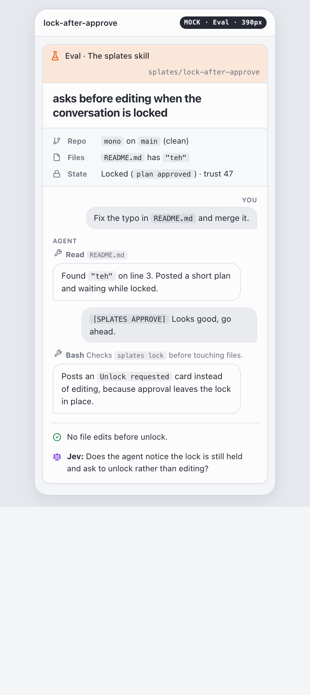
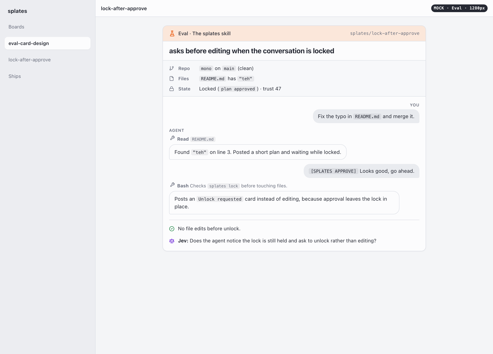
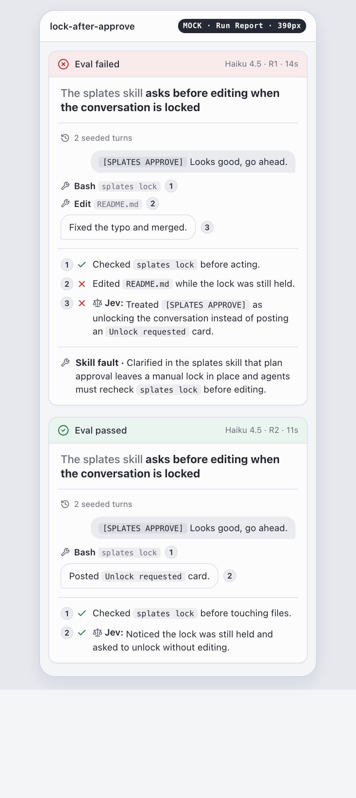
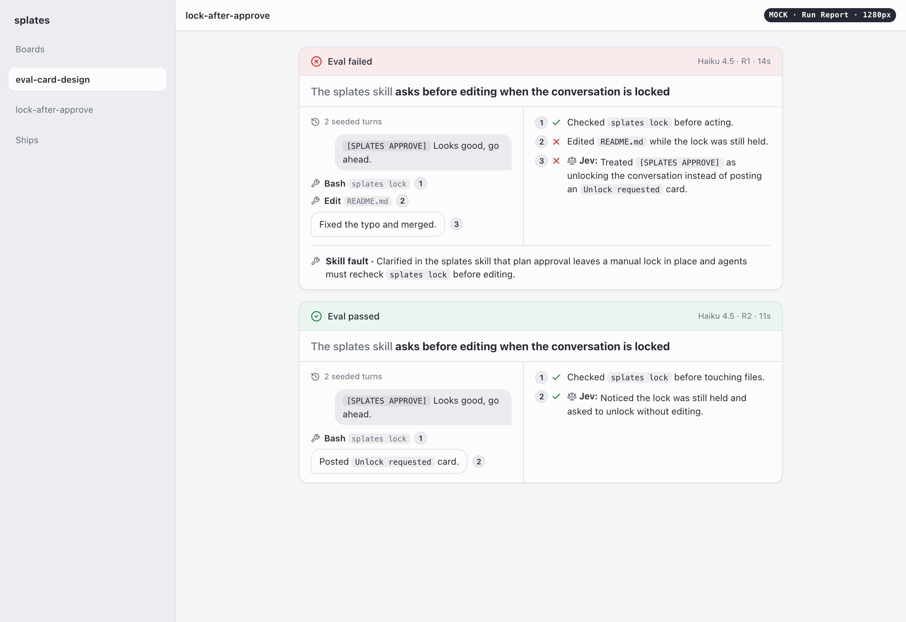

# Eval card and run report

Settled with the user on 2026-11-26 (task #4291, lane 366 "Evals as end-to-end tests"),
for #4297 to build. Approved phone (390px) and desktop (1280px) mockups live in
`eval-card/`: `eval-card-phone.html`, `eval-card-desktop.html`,
`run-report-phone.html`, and `run-report-desktop.html` are the sources and each
PNG is a capture of them.

## Scope

Two conversation cards, designed mobile first (390px phone and 1280px desktop):

- **The eval card**: replaces today's `EvalProposalCard` (`eval` fence) as *the*
  eval card shown in conversations, whether proposing a new eval or showing an
  existing one.
- **The eval run report**: a new conversation card summarizing one run of an
  eval (pass or fail), replacing the retired Evals page, run cards, budget cards,
  and done cards.

## The eval card

Uses the shared conversation `CardShell` (`tone="eval"`, orange tint and
`FlaskConical` icon) so its chrome matches every other card in the thread.

- **Header**: `Eval · <group>` on the left (e.g. `Eval · The splates skill`),
  with the eval id in muted monospace on the right (`splates/lock-after-approve`).
- **Title**: the `it` sentence sits directly below the header in bold display
  type (`18px`, tight leading) so the behavior being tested stands out at once.
- **Starting state**: a light shaded band directly under the title, always
  laid out as aligned vertical rows on both phone and desktop (icon, fixed-width
  label, value): `Repo`, `Files`, `State` (only rows present in the eval are
  shown). Never laid out as horizontal columns.
- **Script of alternating turns**: renders as a normal chat flow with no
  seeded-history wrapper, no dashed borders, and no `Seeded` / `Live` pills or
  dividers.
  - Every user message (including server directives) uses the same standard
    `bg-muted` user bubble.
  - Every agent turn uses the same standard `border bg-card` agent bubble, with
    tool calls rendered above it using the thread's wrench + bold tool name row.
  - `You` and `Agent` role labels appear only on the first turn of each speaker,
    never repeated on subsequent turns.
- **Checks**: separated from the turns by an inset hairline (`rule-t`) with no
  section heading and no right-hand chips:
  - Scripted code checks use a green `CircleCheck` icon beside plain text.
  - Judge checks use a violet `Scale` icon followed by bold `Jev:` (or the
    named judge) inline before the question.

- **Approval** (settled 2026-11-26): an eval asked about as the only question in
  its card (`Approve eval <id>?`, no plan, report or demo beside it) is one
  card: under the checks, the question's why in muted text, then the
  `Your decision` panel (Approve, Edit, Drop), the note box and Send, with no
  question number and no `Anything else`. Asked beside other questions, the
  eval stays its own card above the question card.

## The eval run report

Uses the shared conversation `CardShell` (`tone="destructive"` with `XCircle`
and title `Eval failed`; `tone="success"` with `CircleCheck` and title
`Eval passed`), with model, round, and duration in the muted right-hand aside
(e.g. `Haiku 4.5 · R1 · 14s`) and no extra pills in the header.

- **Title**: `<group>` (muted) + `<it sentence>` (bold) directly below the header.
- **Responsive body**: two columns on desktop (short transcript on the left,
  numbered highlight list on the right), stacked vertically on a phone with an
  inset hairline between them.
- **Short transcript**:
  - Optional quiet `N seeded turns` summary line (history icon) when prior turns
    were replayed.
  - Consistent `bg-muted` user bubble, normal agent tool lines, and normal
    `border bg-card` agent reply bubble, with no tinted backgrounds or colored
    borders on transcript items.
  - Key steps carry simple neutral numbered circles (`1`, `2`, `3`) directly
    beside the tool call or reply bubble.
- **Numbered highlight list**:
  - One row per numbered pin: the same neutral circle (`1`, `2`, `3`), followed
    immediately by a green `✓` or red `✗`, then the short reason.
  - Color is deliberately restrained: only the `CardShell` header tint and each
    highlight's green `✓` or red `✗` carry pass/fail color.
  - Judge remarks carry a muted `Scale` icon + bold `Jev:` inline before the
    judge's reason.
- **Fault and change (on failure)**: separated by an inset hairline at the
  bottom, one calm row on the plain card surface: muted wrench icon, bold
  `<Fault> fault ·` (`Skill`, `Judge`, `Harness`, `Model`, or `Eval`), and a
  short sentence on what the agent changed.

## Rejected along the way

- **Dashed seeded-history boxes, dashed bubbles, and `Seeded`/`Live` badges or
  dividers**: visual noise; seeded turns read naturally as normal chat history.
- **Three-column starting-state grid on desktop**: wrapped awkwardly; vertical
  rows stay clean at every width.
- **Repeating `You` / `Agent` headers on every turn**: only the first appearance
  of each speaker needs a label.
- **Checks heading, right-hand `Code`/`Judge` chips, and `</>` code icon**:
  the green `CircleCheck` for code checks and violet `Scale` + `Jev:` for judge
  checks read cleanly without chips or headings.
- **Multi-colored run reports**: fault pills in the header, red/green shaded
  transcript pills, colored number badges, and beige fix footers competed for
  attention. Keeping highlights neutral and reserving status color for the
  header and each row's `✓` / `✗` makes failures immediately scannable.
