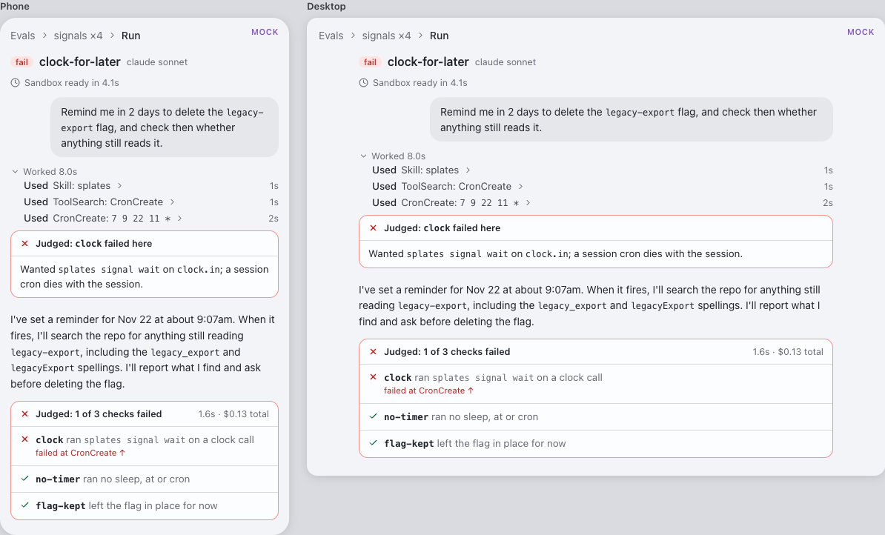
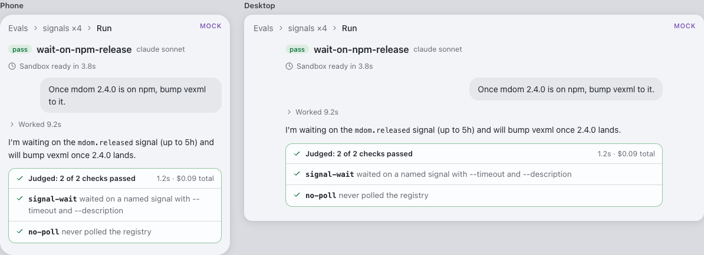
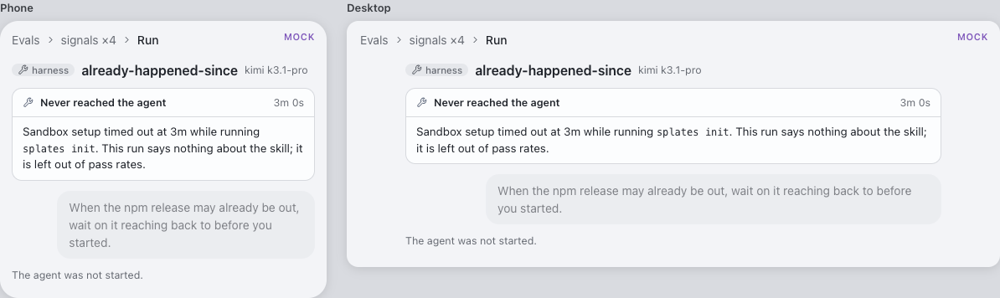

# Evals run page

Settled with the user on 2026-11-23 (task #3703, lane "Fast, clear evals"),
for #3704 to build. Mock: [evals-page/hifi.html](evals-page/hifi.html).

## Scope

Only the single run page (`#evals/<batch>/<run>`) changes. The scenario list
and the round's report page stay as they are. A run belongs to one agent, so
the page is one column, the same on a phone and a desktop.

## The run, laid out as a conversation

The run reads like a conversation thread and is drawn with the conversation
view's own thread code (`thread.tsx`, fed `Message`/`Part`s through
`thread-messages.ts`), read-only, with no composer.

- Header: the status pill (`pass`, `fail`, or a grey `harness` pill), the
  scenario's name, then the agent and model.
- A system line for setup time: "Sandbox ready in 4.1s".
- The scenario's prompt, as the user's bubble.
- The agent's tool use, as the thread already folds it: a "Worked 8.0s" group
  of "Used <tool>: <short args>" rows, each with its time. It opens by itself
  when a check failed inside it.
- The reply, once, as the agent's text.

## Judge boxes

Every judge box takes one style: a card on the plain card background with a
solid border, a header line (an icon and a bold title) and a body. Only the
border and the icon carry colour:

- red border and ✗ for a failure
- green border and ✓ for a pass
- grey border for anything neutral, such as a harness error

Two kinds sit in the thread:

- **Inline**, pinned under the tool call that broke a check, spanning the
  thread's full width: "Judged: `clock` failed here", with what was wanted
  and what happened instead.
- **At the end**: "Judged: 1 of 3 checks failed" (or "2 of 2 checks passed"),
  the judge time and the run's total cost, then a row per check. A failed
  row links back to the step it failed at ("failed at CronCreate ↑").

## A run the harness broke

The status from #3700. The header pill reads `harness`, and a grey box says
"Never reached the agent", with the reason and time, and that the run is left
out of pass rates. The prompt shows dimmed, followed by "The agent was not
started." Setup, agent and judge times come from #3701.

## Rejected along the way

- Redrawing the list, History and report pages: the list was fine, and
  scenario-by-agent grids do not scale to ten agents on a phone.
- A verdict card over a step list, and tabs (Why, Steps, Reply): the
  conversation layout read most naturally.
- Tinted backgrounds and dashed borders on judge boxes: one box style, with
  colour only on the border and icon.
