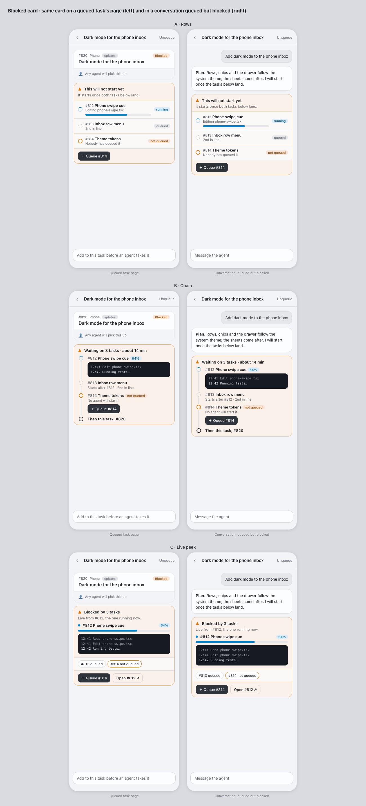

# Blocked card

Settled 2026-11-15: the look of the card for a task that is queued but held
back by other tasks. A static mock in the app's colors and type; the build
follows its layout and wording.

`variants.html` is the mock's source; **A, Rows** is the pick.

- **One card, everywhere.** The same card shows on a queued task's page,
  after the task card, and in a conversation that is queued but blocked, in
  place of the queue banner, so the blocked state looks the same wherever it
  is met.
- **Shape.** The amber panel the queued task page has today: "This will not
  start yet", a line on why, then one row per blocker. A row has a status
  mark, the number and subject, a line of detail, and a state pill (running,
  queued, not queued).
- **Live.** A running blocker's row shows its latest update line and a
  progress bar; a queued one says where it stands in line.
- **Fix.** A blocker nobody has queued gets its Queue button at the foot of
  the card, as today.
- **Not picked.** Chain (a vertical chain ending in "Then this task") and Live
  peek (the running blocker's log tail in the card) stay as mocks.
