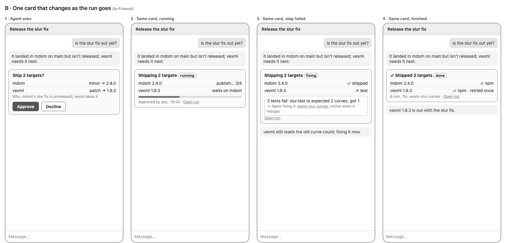

# Ship cards in a conversation

The picked look (lo-fi, layout only) for what a conversation shows about a ship:
**one card that changes as the run goes.**

1. **Ask.** An agent asks to ship with a card listing each target, its bump and
   the version it becomes, and a line on why. Approve and Decline; Approve is
   the only way an agent starts a ship.
2. **Running.** Approve turns that same card into the run's card: each target
   on a line with its current step, a progress bar, who approved and when, and
   a link to the run. It updates in place; nothing new is posted.
3. **Failed step.** The card shows the failed step on its target's line, the
   error in short, and the agent fixing it with its task linked, and says the
   ship retries once the fix merges. The agent's own message follows in the
   thread as usual.
4. **Finished.** The card turns to done: each target shipped and where, any
   step retried, how long it took, the fixing task and the run link.

Not chosen: a new card for each moment (A), and a pinned bar while it runs
with one-line entries in the thread (C).
