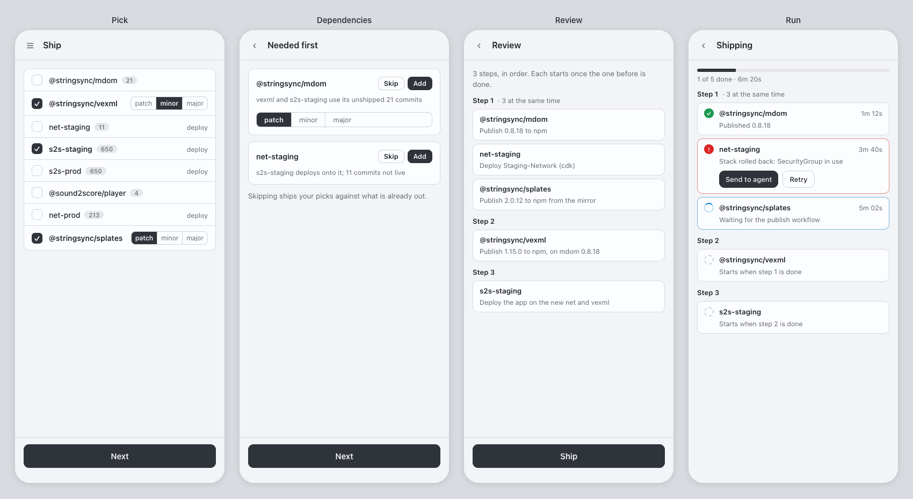

# Ships flow

Settled 2026-11-15, for the new ship (lane 182, Ship overhaul): the picked
look for the Ships page on a phone, from four variants. A static mock in the
app's colors and type; the build follows its layout and wording.

`flow.html` is the mock's source.

- **Pick.** A flat list of everything shippable, one line each: a checkbox,
  the name, its unshipped commit count, and "deploy" for a deploy. A picked
  package shows patch, minor and major on its row instead of the count.
  Several can be picked. Nothing else on the screen; Next at the bottom.
- **Needed first.** The targets the picks need shipped first, on
  their own screen as the same checkbox list as the picks (changed
  2026-11-16, from the user's hand test: Skip and Add read as buttons, not a
  choice). Each has a checkbox and, once ticked, its bump; a line under the
  list says why each is needed. Unticked ships the picks against what is
  already out. Next at the bottom.
- **Review.** The plan as numbered steps, "Step 1", "Step 2", and so on,
  run in order, each starting once the one before is done. Each step is a
  list of full-width cards, one per target, however many run in it; a step
  with more than one says so ("3 at the same time"). Each card shows the
  target and its `does` line. One button: Ship.
- **Shipping.** The same steps and cards, each target with its state
  (done, failed, running, waiting), its latest update line and the time it
  took; a waiting target says which step it starts after. A failed target
  has Send to agent and Retry. A bar and "1 of 5 done" with the time so far
  sit on top. A run that survived a restart looks the same.
