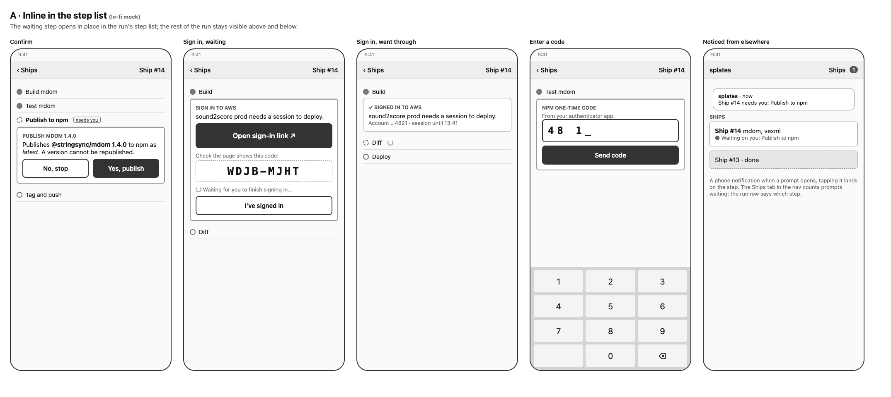

# Ship prompts

Settled 2026-11-15, for the new ship (lane 182, Ship overhaul). A lo-fi mock:
it settles layout, not look.

`prompts.html` is the mock's source.

- A step that needs the user opens in place in the run's step list, as a
  card under the step, marked "needs you". The rest of the run stays visible,
  so two prompts from steps running in parallel show at once.
- Confirm: the step's name, what it will do, and No (stops the ship) and Yes.
- Sign in: the link as a large button that opens it, the code to match when
  there is one, a waiting line, and an "I've signed in" button for when the
  ship cannot tell by itself. Once through, the card collapses to a signed-in
  line and the next step starts.
- Enter a value: a labelled input with the keyboard to match (a number pad
  for a one-time code) and a Send button.
- Elsewhere in splates: the Ships tab in the nav counts prompts waiting, the
  run's row says "Waiting on you" and which step, and a phone notification
  goes out when a prompt opens, tapping it opening the step.
