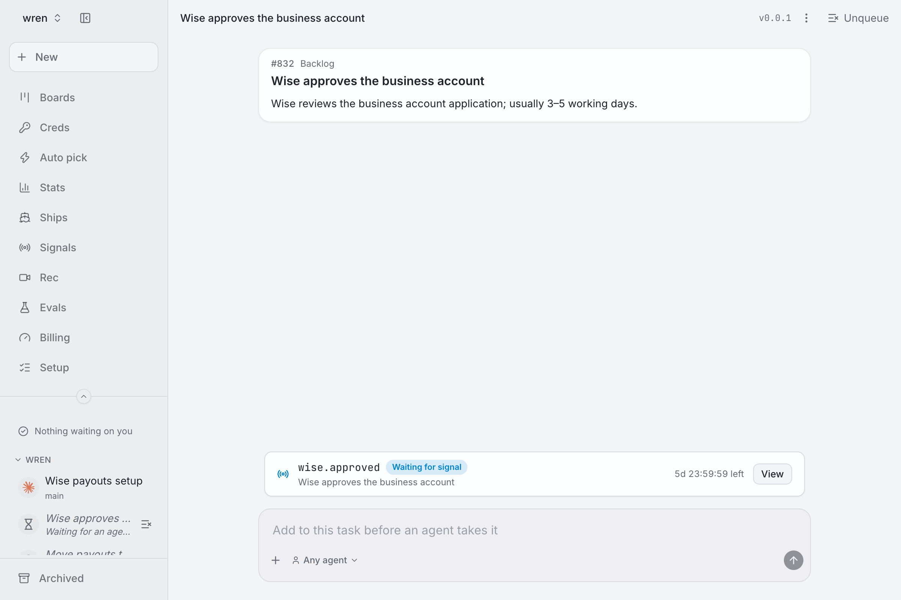

# Signal tasks

Settled 2026-11-21: how a signal (`#<project>.<name>`) blocks work. It does
not become a new kind of blocker. A task can close on a signal, and that task
blocks other tasks the way any task does, so everything built for task
blockers (`blockedBy`, the queue starting what is unblocked,
`[SPLATES BLOCKERS CLEARED]`, `splates merge` refusing while a blocker is
open, the Blocked card) works for it unchanged.

## The task

- `splates task add "<subject>" --closes-on <signal>` adds one;
  `splates task update N --closes-on <signal>` attaches a signal to a task
  already on the board; `splates blocker add --closes-on <signal> "<subject>"`
  adds one from a worktree and blocks the started task on it.
- No agent ever works it: the queue never starts it.
- Only a firing after the signal was attached counts, unless it is
  configured to take an earlier one: `--since <time>`, as `signal wait`
  takes it.
- When the signal fires, the task closes as if it merged: each task it
  blocked records it as landed, with the firing (when, payload) in place of
  a commit. Closing the task is the durable mark, so the firing itself need
  not be kept.
- The board subscribes to the signal while the task is open, so a probe on
  that name (`splates signal poll`) keeps running for it and the Signals page
  lists it. A probe timing out, a broken check or the signal expiring never
  closes the task: it stays open until the signal fires or someone removes
  it, which unlinks it as removing any task does.

## The look

No new UI.

- **The task's own page** is its task card, and the existing signal bar
  (the slim bar a conversation shows while it waits on a signal) attached
  above the composer, where a queued task shows its place in line.
- **The Blocked card** is unchanged: a dash for a blocker nobody has
  queued, a check for one with nothing left for the person to do. A task
  that closes on a signal needs nothing from the person, so it gets a check
  and no Queue button.
- The task card has no assignee footer and no stage chip; that change, and
  showing the card in a conversation in place of the user-styled goal
  message, is its own task (#3389).

## Not picked

A new `signal` blocker kind stored on the blocked task, and a signal row,
chip or strip on the Blocked card: the person learns what closes a blocker
by opening it.
