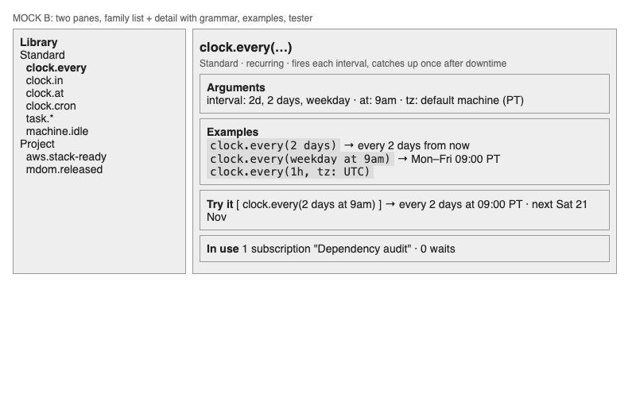

# Standard signals

Agents wait on and subscribe to signals for everything that happens later or
again: "in two days", "every two days", "when the stack is up", "when #812
lands". Splates ships a standard library of signal functions, projects declare
their own in `splates.config.ts`, and automations shrink to Auto pick, which
only routes work to an agent.

## Before

```d2
direction: right
automations: Automations {
  triggers: "event | every | cron | signal"
  actions: "agent prompt | shell | groomer"
  triggers -> actions
}
autopick: Auto pick (card on Automations)
signals: Signals {raise; wait; probe}
signals -> automations.triggers: "signal trigger"
```

Automations hold four trigger kinds and three actions. Signals have no
built-ins, waits cap at 7 days, and a wait on a name nothing raises can last
forever.

## After

```d2
direction: right
std: Standard signal functions {
  clock: "clock.in | clock.interval | clock.at | clock.cron"
  task: "task.created … task.done"
  machine: "machine.idle"
}
project: "Project signal functions (splates.config.ts)"
subs: "Subscriptions (Signals page): on <call> -> prompt | shell"
wait: "signal wait (wakes this conversation)"
autopick: "Auto pick: agent, model, effort"
std -> wait
std -> subs
project -> wait
project -> subs
subs -> autopick: "fresh conversation each run"
autopick -> agent
```

## Calls

A call is a signal function called with arguments:

```ts
clock.in("2 days")                      // one main field: a plain value
clock.in({ after: "2 days" })           // the same signal
clock.interval({
  interval: "2 days",
  at: "9am",
  tz: "America/Los_Angeles",            // optional; default the machine's zone
})
task.done({ task: 812 })
machine.idle({ for: "10m" })
aws.stack-ready({ stack: "sound2score-prod" })
```

- The argument is JSON5 (unquoted keys, single quotes, trailing commas,
  comments, newlines). It is parsed, never evaluated. The call ends at
  the parenthesis matching its first, so it may span lines in a message or a
  `signal wait` argument.
- A signal function with one main field takes a plain value in place of the object,
  mapped to that field.
- Values may be words (`"2 days"`, `"9am"`, `"next monday"`); the signal function
  parses them and refuses one it cannot read, never storing a guess.
- The canonical form sorts keys and normalizes values: two spellings of the
  same call are one signal and share one timer or probe. Cards show the
  canonical call and its resolved meaning ("every 2 days at 09:00 PT,
  next Sat 21 Nov").
- Prefixes `clock.`, `task.` and `machine.` are reserved; no project may use
  them.

## Standard signal functions

| Signal function | Main field | Fires |
|---|---|---|
| `clock.in` | `after` | once, after a delay |
| `clock.at` | `time` | once, at a time |
| `clock.interval` | `interval` (+ `at`, `tz`) | each interval; catches up once after downtime |
| `clock.cron` | `expr` (+ `tz`) | on a cron schedule |
| `task.created`, `.queued`, `.started`, `.done`, `.dropped`, `.updated` | `task` (+ `lane`, `stage`) | on the task event |
| `machine.idle` | `for` | once the machine has been idle that long |

Clock waits may run up to a year; other waits keep the 7-day cap.

## Project signal functions

Declared in `splates.config.ts`, so an agent adds one through a task:

```ts
signals: {
  "aws.stack-ready": {
    description: "A CDK stack reaches CREATE_COMPLETE or UPDATE_COMPLETE",
    args: { stack: { type: "string", description: "CloudFormation stack name" } },
    main: "stack",
    examples: ['aws.stack-ready("sound2score-prod")'],
    poll: { interval: "5m", script: "bin/probes/stack-ready" }, // args as JSON in $SPLATES_ARGS
  },
  "mdom.released": {
    description: "A new mdom version is on npm",
    args: { range: { type: "string", description: "semver range", optional: true } },
    // no probe: raised by mdom's ship
  },
}
```

Fields are a plain `{ type, description, optional }` object, shown as is in
the library.

## Known sources and removal

- A wait is refused unless its signal has a known source: a standard signal function,
  a declared signal function, a running probe, or a raise in the last 7 days. The
  refusal says how to declare it.
- A subscription is held to the same rule: one on a signal with no known
  source is refused, since it could never fire.
- A raise with no waiter or subscriber is still kept for 7 days, so a later
  wait with `--since` or a new subscription can see it, and the Signals page
  can show it. A probe or clock with no waiter and no subscription does not
  run.
- The library shows standard and declared signal functions only; an undeclared
  signal shows on the Signals page's live list, not in the library.
- Removal reaches every dependent. When a signal is removed (its poll script
  stopped, replaced or timed out, a clock cancelled, a signal function undeclared),
  every wait wakes with `[SPLATES SIGNAL <call>] removed: <why>`, and every
  subscription on it pauses with a card to the user. A one-time clock that
  has fired ends its subscriptions the same way, marked finished.

## Subscriptions

What automations did with a trigger becomes a subscription on the Signals
page: `on <call>` run a prompt or a shell command.

- Each run of a prompt subscription starts a fresh conversation, its agent
  chosen by Auto pick unless the subscription fixes one.
- The groomer becomes a built-in subscription on `task.created`; the
  `on:` shell hooks in `splates.config.ts` become shell subscriptions; saved
  automations migrate to subscriptions in place.

## Library view

- Agents: `splates signal library [signal function]` prints signal functions, fields,
  examples and current users; the skill points to it.
- People: a Library pane on the Signals page, the signal function list beside the
  chosen signal function's fields, examples, a tester and where it is used. The `#`
  composer picker and the subscription form offer the same signal functions and fill
  in a template.



## Auto pick

The Automations page becomes the Auto pick page: routing only. A separate
task makes Auto pick track provider errors (5xx and 503s from runs, provider
status pages) and steer away from failing models.

2026-11-19: recurring clock signal function named `clock.interval` by user decision.
