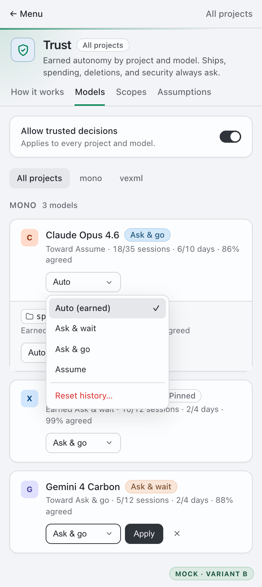
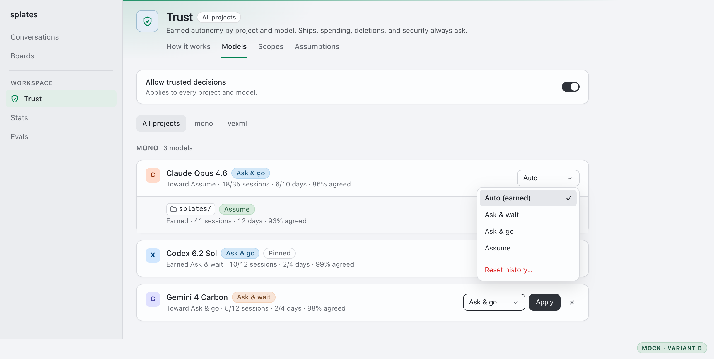
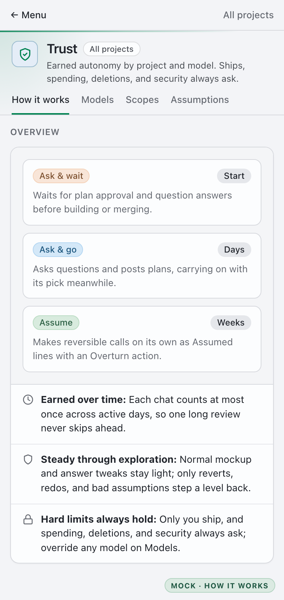
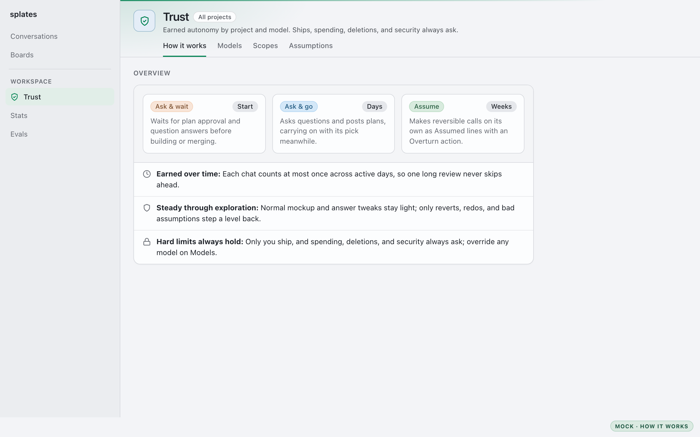
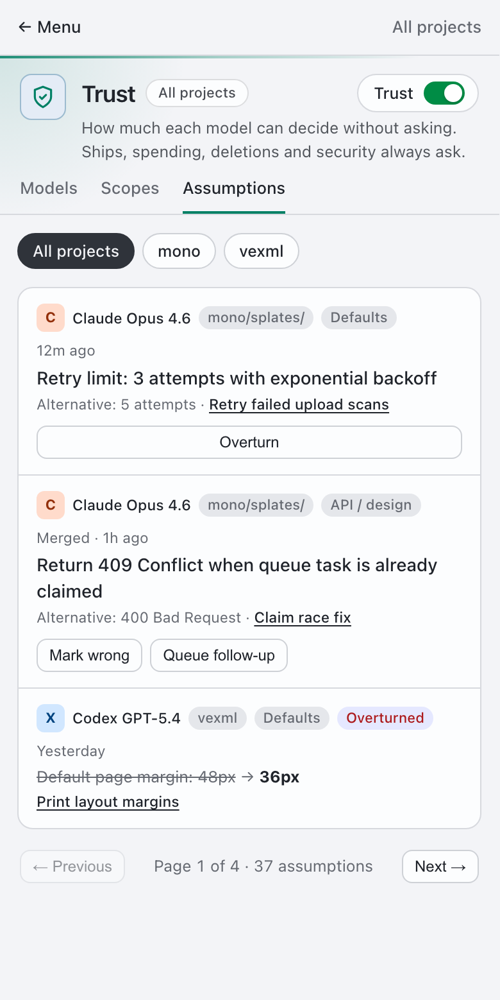
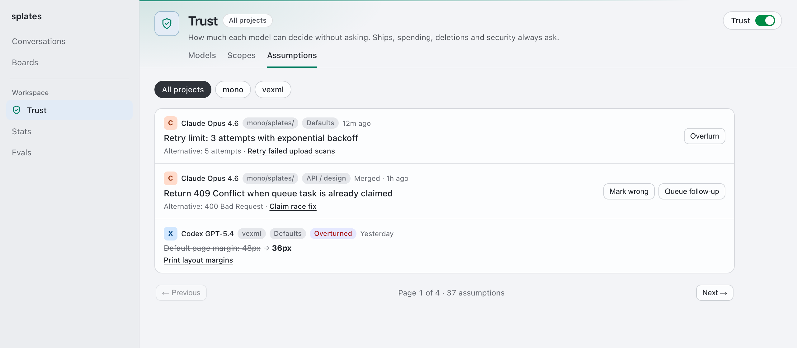

# Trust page and earned trust levels

## Earned trust levels, simplified Trust page, and removing conversation trust chrome (#4647)

Settled with the user on 2026-11-27 (task #4647, lane 399 "Earned trust levels")
for #4648 (scoring engine and band override storage), #4649 (CLI and agent
skill), and #4650 (Trust page and conversation cleanup) to build. Supersedes the
0–100 Beta score, 0–100 slider/ruler, 5-kind breakdown bars, detailed weight
tables on `How it works`, and all conversation trust widgets, hairline shield
badges, and per-event Undo drawers from #4149 and #4303 below.

Approved hi-fi mocks (responsive phone 390px + desktop 1280px):
[trust/earned-models.html](trust/earned-models.html),
[trust/earned-overview.html](trust/earned-overview.html).

### Session-bounded scoring & weighting (#4648)

- **Three earned levels, no 0–100 score:** Models start at `ask-and-wait`
  (`Ask & wait`) and earn `ask-and-go` (`Ask & go`) and `assume` (`Assume`) by
  meeting session, active-day, rolling agreement, and clean-streak milestones,
  with hysteresis buffers before stepping down.
- **Session grouping (1 session max per conversation):**
  - Active decisions (`!undone`, and `at >= resetAt` when `resetAt !== null`)
    group into sessions by `conversation` id when non-null, or by standalone
    decision `id` (`revert:<sha>`, `redo:<task>`) when `conversation === null`.
  - Order sessions chronologically by their latest active decision timestamp
    (`at`).
  - Within each session, count:
    - `kept`: `outcome === "kept"` (`question`, `mockup`, `plan`)
    - `taste`: `outcome === "overturned"` where
      `source === "question" || source === "mockup"`
    - `planBack`: `outcome === "overturned"` where `source === "plan"`
    - `broken`: `outcome === "overturned"` where
      `source === "unasked" || source === "redo" || source === "revert"`
    - `amended` outcomes add `0` for and `0` against.
  - A session is **counted** when `kept + taste + planBack + broken > 0`.
    Sessions with only `amended` outcomes leave session count, active days,
    clean streak, and agreement untouched.
- **Bounded session credit:** Let `M = kept + taste + planBack`:
  - `for = M > 0 ? kept / M : 0` (at most `1.0` per conversation, whether 1 kept
    pick or a 30-question mockup sweep).
  - `against = (M > 0 ? (0.5 * taste + 1.0 * planBack) / M : 0) + 2.0 * broken`
    (routine mockup/question taste changes weigh half inside the session; a plan
    sent back weighs 1 session; broken-trust incidents weigh 2 sessions against
    and reset the clean streak).
- **Standing metrics:**
  - `sessions`: total counted sessions since `resetAt`.
  - `activeDays`: count of distinct `YYYY-MM-DD` calendar dates
    (`at.slice(0, 10)` of each counted session) across counted sessions since
    `resetAt`.
  - `agreement`: `Math.round((100 * sum(for)) / sum(for + against))` over the
    **last 25 counted sessions** (or all counted sessions while fewer than 25;
    `null` when `0` counted sessions or `sum(for + against) === 0`).
  - `cleanStreak`: consecutive counted sessions from newest backward with
    `broken === 0`. Also track `brokenInLast5` and `brokenInLast10` (sum of
    `broken` in the last 5 and 10 counted sessions).

### Promotion milestones & hysteresis (Balanced preset)

Evaluate sequentially across counted sessions starting at `ask-and-wait`,
stepping at most one level up per session:

- **Start:** `ask-and-wait`.
- **Promote `ask-and-wait` → `ask-and-go`:** `sessions >= 12` AND
  `activeDays >= 4` AND `agreement !== null && agreement >= 80` AND
  `cleanStreak >= 5` (`brokenInLast5 === 0`).
- **Demote `ask-and-go` → `ask-and-wait` (hysteresis):**
  `(sessions >= 5 && agreement !== null && agreement < 65)` OR
  `brokenInLast10 >= 2`.
- **Promote `ask-and-go` → `assume`:** `sessions >= 35` AND `activeDays >= 10`
  AND `agreement !== null && agreement >= 88` AND `cleanStreak >= 10`
  (`brokenInLast10 === 0`).
- **Demote `assume` → `ask-and-go` (hysteresis):**
  `(agreement !== null && agreement < 78)` OR `brokenInLast5 >= 1` (any
  reverted merge, redone task, or overturned assumption immediately steps
  `Assume` down to `Ask & go`, requiring 10 clean sessions to re-enter
  `Assume`; if the `ask-and-go` demotion condition also holds at that session,
  it falls through to `ask-and-wait`).

### Overrides, migration, and enforcement (#4648, #4649)

- **Modes:** `"dynamic"` (shown as **`Auto`** in the UI) earns its level from
  milestones; `"static"` (shown with a **`Pinned`** badge) pins a `TrustBand`
  (`"ask-and-wait" | "ask-and-go" | "assume"`).
- **Static migration:** Existing `~/.splates/trust-settings.json` records with a
  legacy numeric `value` (`0–100`) migrate transparently on read and save:
  `< 70` → `"ask-and-wait"`, `70–89` → `"ask-and-go"`, `>= 90` → `"assume"`.
  Numeric `dynamicBase` / `dynamicAt` is retired.
- **Effective band & enforcement:** When global `Allow trusted decisions` is off,
  every bucket resolves to `"ask-and-wait"` while preserving stored settings and
  history. Server enforcement stays identical: merges below `ask-and-go` require
  an approved plan, and only the user ships. `askingKinds` continues to send a
  decision kind back to asking after an overturned assumption until `3` asked
  picks of that kind are kept.
- **CLI & skill (#4649):**
  - `splates add` / `claim` `trust:` line and `splates trust list` report the
    effective band, `auto` vs `pinned`, earned standing (`sessions`, `days`,
    `agreement%`), and any `askingKinds` without `/100`.
  - `splates trust static <target> <ask-and-wait|ask-and-go|assume>` pins a
    level (and `splates trust set <target> <auto|ask-and-wait|ask-and-go|assume>`
    accepts band names or `auto`); `splates trust dynamic <target>` returns to
    `Auto`; `splates trust reset <target>` clears history back to 0 sessions
    (`Ask & wait`, `Auto`).
  - Update `splates/skills/splates/SKILL.md`, `references/proposing.md`, and
    `references/questions.md` to reference earned levels (`below ask-and-go`,
    `ask-and-go`, `assume`) with no 0–100 numeric cutoffs.

### Simplified Trust page & consistent app chips (#4650)

- **App-consistent chips everywhere on Trust:**
  - Level badges (`Ask & wait`, `Ask & go`, `Assume`): canonical `Badge`
    (`variant="outline"`) with `.scorecard-verdict` (`--warning`, `--info`,
    `--success` tinted fill and border).
  - Neutral tags (`Pinned` on `Models`; `Start`, `Days`, `Weeks` on `Overview`):
    `Badge` (`variant="outline"` for `Pinned`, `variant="secondary"` for step
    tags).
  - Declared directory scopes: bordered monospace folder chips matching
    `FileChip` / `NamedChip`.
  - Project filter bar (`All projects`, `mono`, …): standard `Button`
    (`variant="secondary"` when active, `variant="ghost"` otherwise, `size="sm"`),
    matching `StatsPage` instead of custom dark filled stadium ovals.
- **Models tab (dropdown override + explicit `Apply`, no accordion or kind bars):**
  - Separate `Card` per model inside each project's `PageSection`, with declared
    directory scopes as nested rows inside that model's card. Rows do not expand
    and carry no 5-kind breakdown bars.
  - **Left side (where the agent stands):** agent mark (or folder chip for
    scopes), model name, effective level `Badge`, `Pinned` outline `Badge` when
    pinned, and a concise standing line that remains visible even when pinned:
    - Dynamic at `Ask & wait`:
      `Toward Ask & go · 5/12 sessions · 2/4 days · 88% agreed`
    - Dynamic at `Ask & go`:
      `Toward Assume · 18/35 sessions · 6/10 days · 86% agreed`
    - Dynamic at `Assume`: `Earned · 41 sessions · 12 days · 93% agreed`
    - Static (`Pinned`):
      `Earned Ask & wait · 10/12 sessions · 2/4 days · 99% agreed`
    - When `askingKinds` is non-empty, append `· asks first on <kinds>`.
  - **Right side (dropdown + confirmation):**
    - At rest, shows only a compact dropdown (`Auto` when dynamic, or the pinned
      level name when static) whose menu lists `Auto (earned)`, `Ask & wait`,
      `Ask & go`, `Assume`, a separator, and destructive `Reset history…`.
    - Picking a different mode/level stages the selection locally without saving
      and reveals **`Apply`** (`Button size="sm"`) and cancel (`✕`,
      `Button variant="ghost" size="icon-sm"`) beside the dropdown; clicking
      `Apply` saves the override.

- **How it works tab (single high-level `Overview` card):**
  - One `PageSection` (`Overview`) wrapping a single `Card`:
    - Top 3-column strip (1 column on phone) for `Ask & wait` (`Start`),
      `Ask & go` (`Days`), and `Assume` (`Weeks`), each with one plain sentence.
    - Three concise takeaway rows beneath (`Earned over time`,
      `Steady through exploration`, `Hard limits always hold`).

- **Scopes, Assumptions, Rule suggestions, and master toggle:** Kept intact,
  using the same app-consistent chips and project filter buttons (and removing
  any 0–100 score references).

### Removing trust details from conversations (#4650)

- Conversations no longer display any trust widget, popover, hairline shield
  badges (`TrustBadge`), or expandable trust-change / Undo drawers
  (`TrustChange`).
- Remove `useConversationTrust` / `TrustContext` badge wiring from
  `thread.tsx`, `question-cards.tsx`, `event-lines.tsx`, `assumed-line.tsx`, and
  `splates-event-fixtures.ts`, and do not add a Trust card to `Widgets`.
- Plain `Assumed` hairlines (`🛡 Assumed [Retry limit: 3] (vs 5 · Defaults)`
  with `Overturn`) and `Overturned` hairlines (`✗ Overturned [Retry limit: 3 → 5]`
  with no trailing trust badge) remain so reversible assumptions stay visible
  and overturnable in the thread.

---

## Earlier decisions (2026-11-25 #4149 and 2026-11-26 #4303, superseded where noted above)

Settled with the user on 2026-11-25 (task #4149, lane 351 "Agent trust"), for
#4151 (Trust page), #4152 (Conversation trust widget), and #4153 (Ask or assume
by trust, with Assumed events and assumptions log) to build.

Interactive HTML mocks (responsive phone + desktop):
[trust/models.html](trust/models.html), [trust/scopes.html](trust/scopes.html),
[trust/assumptions.html](trust/assumptions.html),
[trust/widget.html](trust/widget.html), [trust/events.html](trust/events.html).

### Scopes tab (#4151, still active)

- Manages optional declared directory scopes per project (**add and remove
  only**, with no editing of an existing scope path).
- Top bar lets the user pick a project, enter a directory path prefix (such as
  `splates/` or `sound2score/billing/`), and click **Add scope**.
- Each project lists its declared scopes with model/session counts and a
  **Remove** button (removing a scope returns models to the project default for
  future decisions). Decisions in a declared scope update that scope's trust;
  tasks outside any declared scope use the project default.

### Assumptions tab & Overturn behavior (#4153, still active)

- A calm, **paginated log** of assumptions made across projects, newest first,
  with **no** unreviewed badge on the tab and **no** `Keep` / `Keep all` review
  queue.
- Each row shows the model, project/scope, decision kind, timestamp, what was
  assumed, the recorded alternative, and a link to the conversation.
- Action per row depends on conversation state:
  - **Open or asleep (non-archived, non-finished) conversation:** `Overturn`
    (sends the overturn message into the conversation so the agent switches to
    the alternative, records the broken-trust overturn, and sends that kind back
    to asking first for 3 kept picks).
  - **Finished (merged/removed) or archived conversation:** `Mark wrong`
    (records the broken-trust overturn and sends that kind back to asking first
    without reopening the conversation) and an optional `Queue follow-up`
    button.
  - **Already overturned:** shows an `Overturned` badge and the old → new text.
- Pagination footer at the bottom (`← Previous`, `Page N of M · K assumptions`,
  `Next →`).

### Historical 0–100 Models, How it works, Widget, and Thread badges (superseded by #4647)

- 0–100 Beta score, slider, and 5-kind breakdown on `Models`
  ([trust/models-phone.png](trust/models-phone.png),
  [trust/models-desktop.png](trust/models-desktop.png)): superseded by earned
  levels + dropdown `Apply` override in #4647.
- Detailed weight table and 0–100 band ruler on `How it works`
  ([trust/key-phone.png](trust/key-phone.png),
  [trust/key-desktop.png](trust/key-desktop.png)): superseded by the single
  `Overview` card in #4647.
- Conversation trust widget and hairline `+n` / `−n` shield badges + Undo drawer
  ([trust/widget-phone.png](trust/widget-phone.png),
  [trust/events-phone.png](trust/events-phone.png)): removed from conversations
  in #4647.
