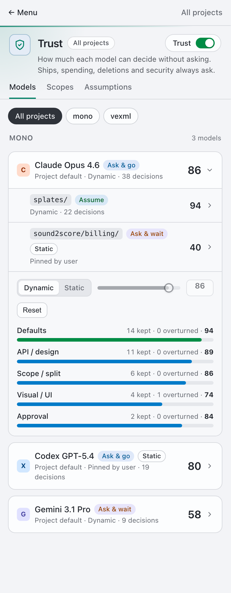
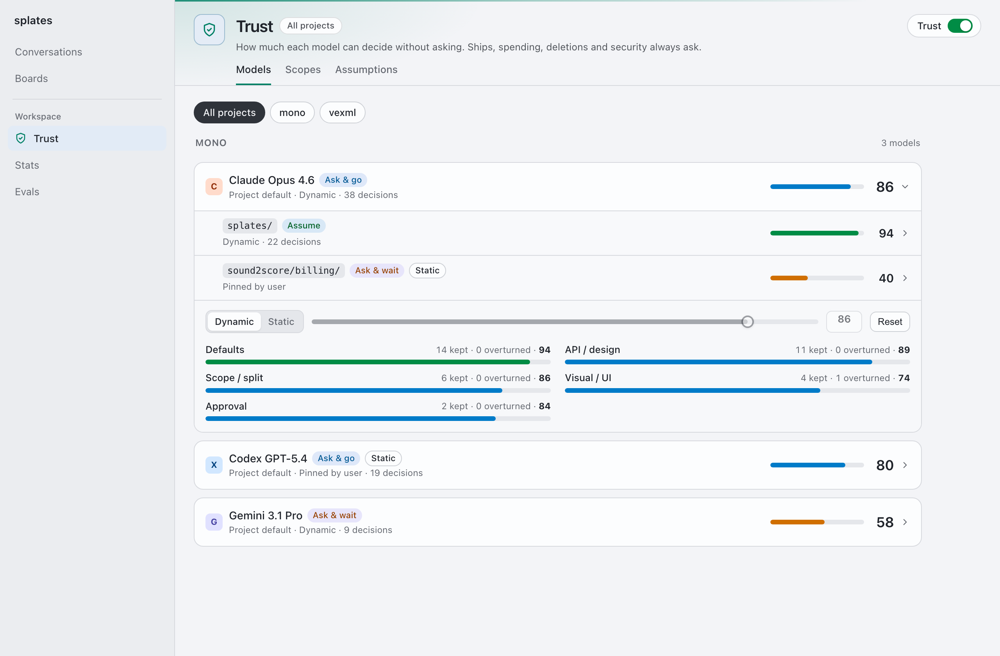
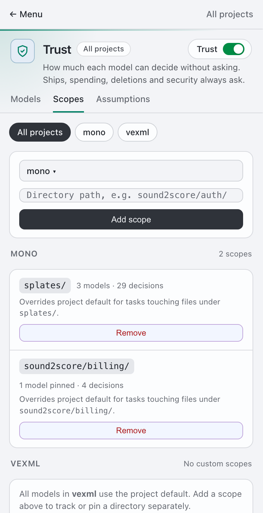
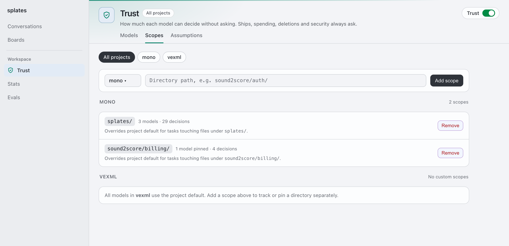
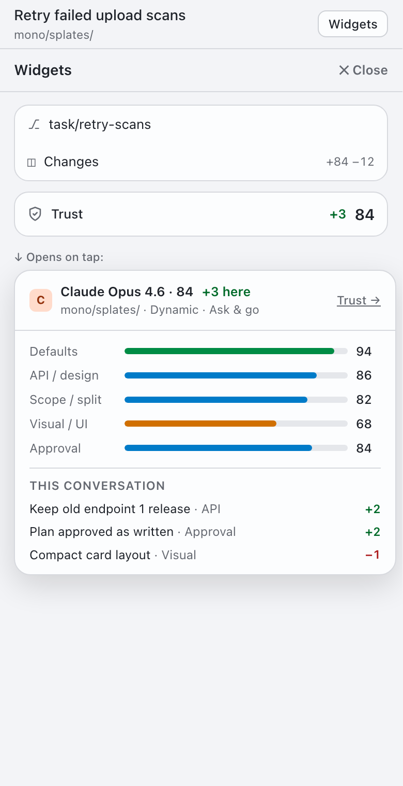
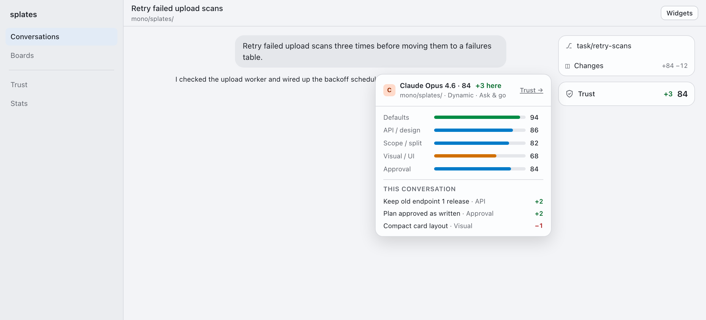
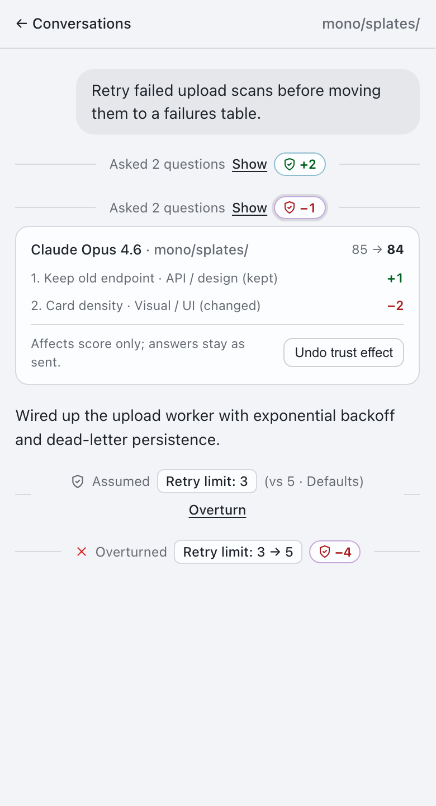
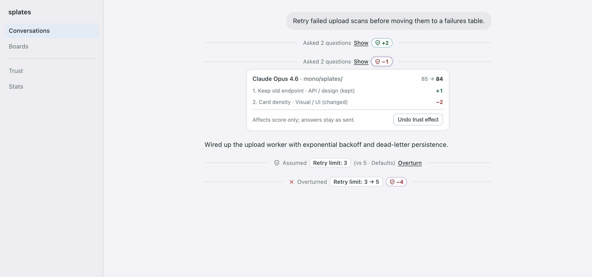
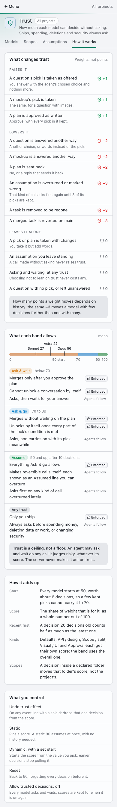
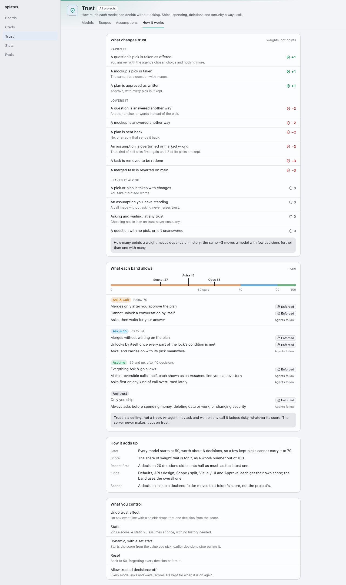

# Trust page, conversation widget, and thread trust events

Settled with the user on 2026-11-25 (task #4149, lane 351 "Agent trust"), for
#4151 (Trust page), #4152 (Conversation trust widget), and #4153 (Ask or assume
by trust, with Assumed events and assumptions log) to build.

Interactive HTML mocks (responsive phone + desktop):
[trust/models.html](trust/models.html), [trust/scopes.html](trust/scopes.html),
[trust/assumptions.html](trust/assumptions.html),
[trust/widget.html](trust/widget.html), [trust/events.html](trust/events.html).

## Trust page (#4151)

A workspace-wide Trust page (`All projects` scope pill) using the standard
atmospheric page header band with a shield-check icon, a **master on/off
toggle** in the header row, and three docked tabs: **Models**, **Scopes**, and
**Assumptions**.

- **Master on/off toggle:** pauses trust-based assuming globally when switched
  off (agents ask as normal while scores and settings remain preserved).
- **Project filter chips:** `All projects` plus one chip per project, shared
  across tabs.

### Models tab

- Grouped by project, with **each model in its own separate card**.
- A model card shows the model's project-default trust (0–100), band pill
  (`Assume` ≥ 90, `Ask & go` 70–89, `Ask & wait` < 70), `Dynamic` or `Static`
  state, decision count, and progress meter (hidden on narrow phone rows to keep
  rows breathable).
- **Nested directory scopes:** any declared directory scopes for that project
  appear nested inside each model card with their own score, band pill, and
  mode (`Dynamic` or `Static`), expandable identically to the project default.
- **Expanding a row** reveals inline controls: a `Dynamic` / `Static` segmented
  toggle, a 0–100 slider and number input (enabled when `Static`), a `Reset`
  button, and the **5-kind breakdown** (`Defaults`, `API / design`,
  `Scope / split`, `Visual / UI`, `Approval`) with kept/overturned counts and
  per-kind scores.

### Scopes tab

- Manages optional declared directory scopes per project (**add and remove
  only**, with no editing of an existing scope path).
- Top bar lets the user pick a project, enter a directory path prefix (such as
  `splates/` or `sound2score/billing/`), and click **Add scope**.
- Each project lists its declared scopes with model/decision counts and a
  **Remove** button (removing a scope returns models to the project default for
  future decisions). Decisions in a declared scope update that scope's trust;
  tasks outside any declared scope use the project default.

### Assumptions tab (#4153)

- A calm, **paginated log** of assumptions made across projects, newest first,
  with **no** unreviewed badge on the tab and **no** `Keep` / `Keep all` review
  queue.
- Each row shows the model, project/scope, decision kind, timestamp, what was
  assumed, the recorded alternative, and a link to the conversation.
- Action per row depends on conversation state (see Overturn behavior below):
  - **Open or asleep (non-archived, non-finished) conversation:** `Overturn`.
  - **Finished (merged/removed) or archived conversation:** `Mark wrong` and an
    optional `Queue follow-up` button.
  - **Already overturned:** shows an `Overturned` pill and the old → new text.
- Pagination footer at the bottom (`← Previous`, `Page N of M · K assumptions`,
  `Next →`).

## Conversation trust widget (#4152)

- Lives inside the conversation's **Widgets** panel (`actions.tsx`), matching
  the plain neutral card surface and border of the existing widget cards (no
  colored/tinted background).
- **At rest**, shows one compact row: shield icon, `Trust`, **plain colored
  tabular net delta** for the current conversation (e.g. green `+3`, red `−1`,
  with **no** chip background, matching `+84 −12` on Changes above it), and the
  model's current 0–100 score.
- **On click/tap**, opens a popover beside the Widgets rail on desktop (or a
  card/sheet on phone) showing:
  - Model, active scope, current score, net delta here (`+3 here`), mode, band,
    and a `Trust →` link to the Trust page.
  - The 5-kind breakdown mini-bars.
  - **This conversation**: recent picks kept or overturned with each decision's
    `+n` / `−n` effect.

## Thread trust events and Assumed lines (#4152, #4153)

All trust-affecting thread events use splates' native centered hairline event
line (`SplatesEvent`):

- **Shield delta badge on every trust-affecting hairline:** anything that
  changes trust (answered question cards, plan approvals, mockup picks,
  overturned assumptions) displays a clickable shield icon plus `+n` or `−n` on
  the event line (e.g. `Asked 2 questions  Show  [🛡 +2]`). Answered questions do
  not add separate "kept/changed" prose pills on the hairline; the shield delta
  carries the outcome cleanly.
- **Expandable trust-change details with Undo and Redo:** clicking a shield
  delta opens a compact inline detail box under the hairline showing the model
  and scope, before → after score, each pick's kind and individual delta, and an
  **`Undo trust effect`** button. Undoing reverses only the trust score impact
  (never changing sent answers or code), dims/strikes the delta on the hairline,
  and flips the button to **`Redo trust effect`** so the user can toggle it back.
- **Assumed event line:** at high trust, reversible assumptions appear as a
  centered hairline event line:
  `🛡 Assumed [Retry limit: 3] (vs 5 · Defaults)  Overturn`
  (no shield delta until overturned, because an unasked pick never raises trust
  on its own).
- **Overturned event line:** once overturned, renders as a centered hairline:
  `✗ Overturned [Retry limit: 3 → 5]  [🛡 −4]` (whose shield delta can also be
  opened and undone/redone).

## Overturn behavior (#4153)

Overturning an assumption always records the double-weighted penalty against
trust and drops that decision kind back to asking first. Whether it also acts on
the code depends on whether the conversation still exists and is open:

- **Active or asleep (still-open, non-archived) conversation:** clicking
  **Overturn** (from the thread hairline or the Assumptions tab) sends the
  overturn message into the conversation (waking the agent if it is asleep) so
  it switches to the alternative, and records the double trust penalty.
- **Finished (merged/removed) or archived conversation:** the action is worded
  **Mark wrong**, which records the double trust penalty and drops that kind
  back to asking first without reopening the conversation or silently creating a
  task. A separate optional **Queue follow-up** button sits beside it when the
  user also wants a task queued to change the merged code.

## How it works tab: scoring and allowed-actions key (#4303)

Settled with the user on 2026-11-26 (task #4303, lane 367 "Trust enforcement
and key") for #4304 (server enforcement and shared definitions), #4305 (the
tab) and the integer-weights scoring change to build.

Hi-fi mock (app tokens, responsive phone + desktop):
[trust/key.html](trust/key.html).

A fourth Trust page tab, **How it works** (not "How trust works", which does
not fit beside the other tabs at phone width), holding four cards in one
column:

- **What changes trust** ("Weights, not points"): every decision source and
  its weight, each with a shield icon in the hairline badge style (shield-plus
  green, shield-minus red, plain shield grey, bare colored text):
  - Raises it: question pick taken as offered **+1**, mockup pick taken
    **+1**, plan approved as written **+1**.
  - Lowers it: question answered another way **−2**, mockup answered another
    way **−2**, plan sent back **−2**, assumption overturned or marked wrong
    **−3** (and that kind asks first until 3 of its picks are kept), task
    removed to redo **−3**, merged task reverted on main **−3**.
  - Leaves it alone (**0**): pick or plan taken with changes (amended),
    assumption left standing, asking and waiting at any trust, question with
    no pick or left unanswered.
  - A note: how many points a weight moves depends on history.
- **What each band allows**: a 0–100 ruler (bands colored, `50 start`, 70,
  90 ticks) with the project's models marked on it (labels staggered so
  close scores do not overlap), then each band's allowed actions, each tagged
  **Enforced** (lock icon: the server refuses otherwise) or **Agents follow**
  (skill prose only):
  - Ask & wait (< 70): merges only after the plan is approved (Enforced);
    asks, then waits (Agents follow).
  - Ask & go (70–89): merges without waiting on the plan (Enforced); asks
    and carries on with its pick (Agents follow).
  - Assume (90+, after 10 decisions for dynamic): everything Ask & go allows
    (Enforced); makes reversible calls itself as Assumed lines (Agents
    follow); asks first on kinds overturned lately (Agents follow).
  - Any trust: only the user ships (Enforced); always asks before spending,
    deleting, or security changes (Agents follow).
  - Closing note: **Trust is a ceiling, not a floor.**
- **How it adds up**: start 50 worth about 6 decisions; score is the share of
  weight for it as a whole number out of 100; half-life 20 decisions; per-kind
  scores (band uses the overall one); declared scopes score separately.
- **What you control**: Undo trust effect, Static, Dynamic with a set start,
  Reset (to 50), Allow trusted decisions off.

Later (2026-11-26, #4305): the band ruler marks no models. Current
standings belong on the Models tab; the key shows only the bands, their
thresholds and the start. Enforced and Agents follow tags sit beside a row's
first line when its text wraps.

### Server enforcement and opt-out

- The server enforces exactly two trust-gated actions: a merge below 70
  needs an approved plan; only the user ships. Both
  respect the `Allow trusted decisions` toggle (off means ask & wait).
- The Assume band is not server-checked: an Assumed line from an agent below
  90 is not flagged.
- **Opt-out:** agents simply choose to ask and wait on any risky call at any
  trust. The server enforces only upper limits, never makes an agent act on
  trust, and asking never costs trust. No plan-card "waits for approval"
  marker.

### Integer weights

Weights are whole numbers: an amended pick or plan moves to 0 (from +½/−½)
and an overturned question or mockup to −2 (from −1.5). Plan sent back stays
−2; unasked, redo and revert stay −3; kept stays +1. This is a scoring change
with its own queued task, landing before #4305 builds the tab.

### Rejected along the way

- A key card on the Models tab (side panel on desktop): replaced by its own
  tab.
- Half weights (+½/−½, −1.5): replaced by integers.
- A plan-card "waits for approval" marker gating merges at any trust.
- Server flagging of Assumed lines below the Assume band.

## Rejected along the way (#4149)

- **Single shared card for all models in a project:** replaced with separate
  cards per model so nested directory scopes visually belong to one model.
- **Flat table with a side detail drawer:** replaced with project-grouped
  per-model cards and inline expand.
- **Top-bar trust pill:** replaced with a compact score-and-delta widget inside
  the existing Widgets panel that opens a popover/sheet on tap.
- **Tinted widget card and tinted delta chip:** removed both backgrounds so the
  widget and its `+n` / `−n` net delta match the plain card and `+84 −12` style
  of neighboring widgets.
- **Editing existing scope paths:** dropped; scopes are add and remove only.
- **Standalone Assumed card and "kept/changed" pills on answered questions:**
  replaced with native centered `SplatesEvent` hairlines carrying clickable
  `🛡 +n` / `−n` badges that open details with Undo/Redo.
- **Unreviewed badge, Keep, and Keep all queue on the Assumptions tab:**
  replaced with a simple paginated log.
